# 3D Cutaway Explainer

An agent skill and code engine for vertical 3D reels in the "How a [crude thing] Becomes a [finished thing]" format. It works for construction, engineering, software, money and any other system you can build up step by step.

Give an agent a topic and it writes the script, generates the voice, builds the 3D world, plans the camera, adds sound and renders a checked MP4.

<p align="center">
  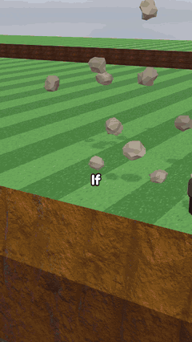
</p>

<p align="center"><em>The example film in this repo: How a Pile of Rocks Becomes a Foundation. The real output is 1080×1920 with voice and sound.</em></p>

## The character kit

Reels built with the kit have dressed, jointed people doing real work, with dust, splashes, smoke and ground detail.

| Dig | Cave-in | Leak | Deep shaft | Finished |
|---|---|---|---|---|
| 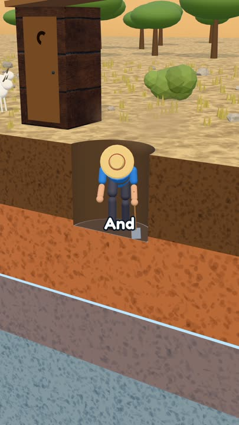 | 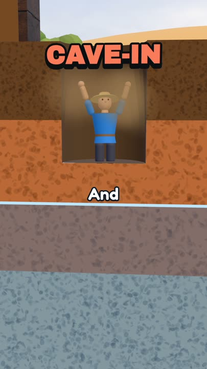 | 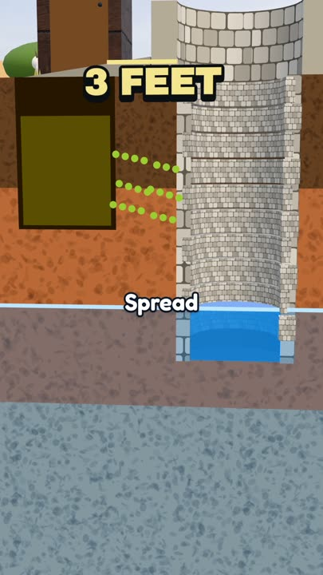 | 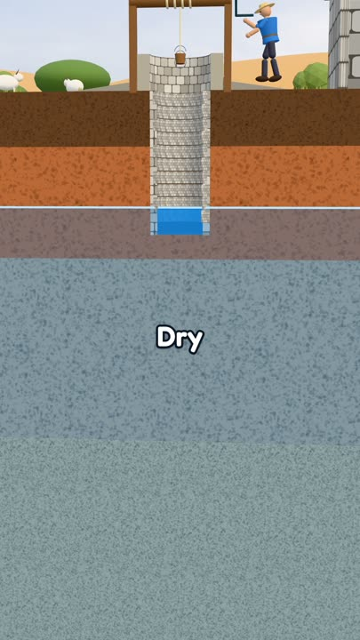 | 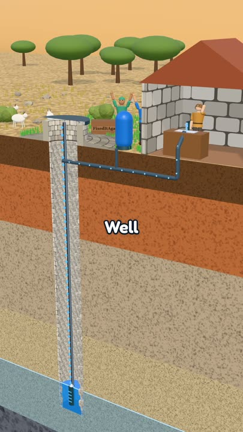 |

## Shot examples

| Hero opening | Low tilt | Section | Macro | Hero ending |
|---|---|---|---|---|
| 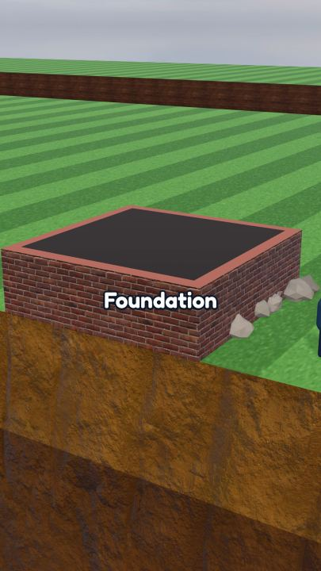 | 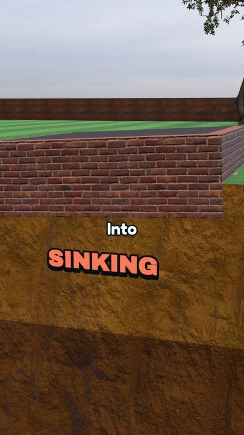 | 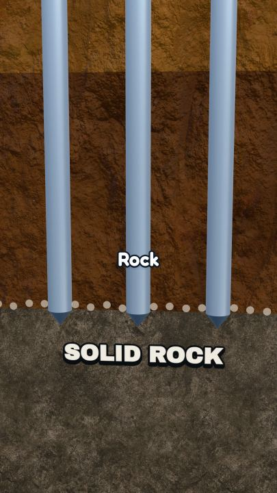 | 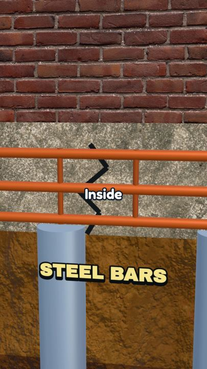 | 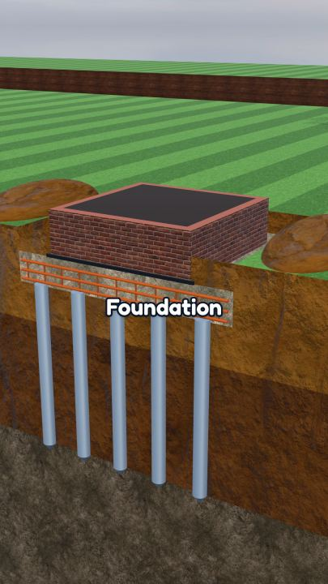 |

## Install

```bash
git clone https://github.com/Joexwilly/3d-cutaway-explainer-engine ~/.claude/skills/3d-cutaway-explainer
~/.claude/skills/3d-cutaway-explainer/bin/cutaway setup
```

Add your Fish Audio key to `~/.config/3d-cutaway-explainer/.env`, or record your own voice. Other agents can clone this repo anywhere and read `SKILL.md`. Full details are in [references/install.md](references/install.md).

## Use

Ask your agent: "Make a cutaway video about how a login form becomes a bank."

Or drive it yourself from any folder:

```bash
cutaway init my-videos --example
cd my-videos
cutaway voice foundation
cutaway sfx foundation
cutaway render foundation
```

Your stories, audio and renders stay in your folder. The skill itself is never edited. Three more full films ship as examples: `cutaway init my-videos --example=well`, `--example=castle` or `--example=igloo`.

## How it stays consistent

| Gate | Blocks |
|---|---|
| Story lint | Scripts that break the format |
| Camera lint | Flat openings, overly long shots, details hidden under captions, before any frame renders |
| Label lint | Labels leaving the safe area in any frame, even during camera moves. `cutaway labels <slug> --fix` repairs them |
| Video QC | Wrong length, cut-off voice, loudness and pacing problems |

## Layout

```
SKILL.md           Workflow an agent follows
bin/cutaway        Command line
references/        Story, topics, camera, sound, world, kit, install, research
examples/          Foundation, igloo, castle and well films
assets/examples/   Framing references from this engine's own renders
src/engine/        Camera, captions, labels, stage, reusable props
src/engine/kit/    Characters, poses, effects, ground detail, world cut
templates/         Starting point for each new story
examples/          A complete example film
scripts/           Voice, sound, lints and QC
```

## Licenses

Code is [MIT](LICENSE). Third-party terms are in [NOTICE.md](NOTICE.md). Remotion has its own license: it is free for individuals and small teams, and larger companies need a paid license.

Use this for your own original topics and scripts.
